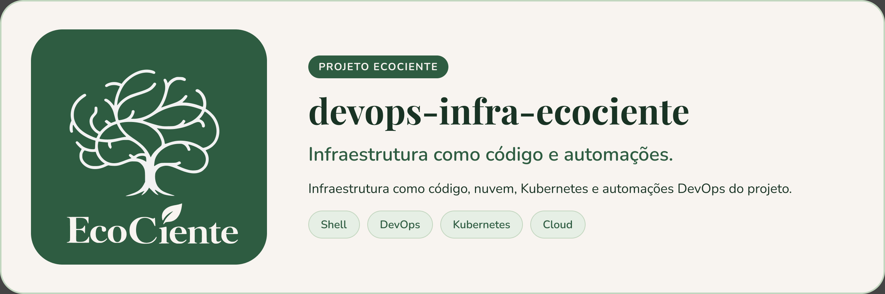

<p align="center">
  
</p>

# EcoCiente - Infraestrutura DevOps


Repositório central responsável pela infraestrutura, automação, documentação operacional e recursos de DevOps do projeto EcoCiente.

> Dados que despertam a consciência.

---

## Objetivo

Este repositório centraliza os recursos compartilhados de infraestrutura do EcoCiente.

As APIs e aplicações continuam mantendo seus próprios arquivos de build, testes e containerização em seus respectivos repositórios.

A responsabilidade deste repositório é manter a infraestrutura global necessária para executar e integrar os serviços do projeto.

---

## Arquitetura atual

A infraestrutura em nuvem utiliza o AWS Academy Learner Lab.

```text
                        Internet
                           |
                           v
                    AWS Academy Lab
                      us-east-1
                           |
                           v
                    Internet Gateway
                           |
                           v
                    EcoCiente VPC
                     10.20.0.0/16
                           |
                           v
                    Public Subnet
                     10.20.1.0/24
                           |
                           v
                    Security Group
                      HTTP / HTTPS
                           |
                           v
                     EC2 t3.large
                    2 vCPU / 8 GiB
                       30 GB gp3
                           |
                           v
                   Amazon Linux 2023
                           |
                           v
                          k3s
                           |
                   Kubernetes Cluster
                           |
                        Traefik
                           |
                         Ingress
                           |
          +----------------+----------------+
          |                |                |
          v                v                v
     APIs Java         API de IA       outros serviços
    Spring Boot         FastAPI          EcoCiente

## Contribuindo

Leia o [CONTRIBUTING.md](CONTRIBUTING.md) antes de abrir uma Pull Request. Ao participar, você concorda com o [Código de Conduta](CODE_OF_CONDUCT.md).

## Segurança

Encontrou uma vulnerabilidade? Siga o [SECURITY.md](SECURITY.md). **Não abra issue pública.**

## Licença

Este projeto está sob a licença MIT. Veja o arquivo [LICENSE](LICENSE).
